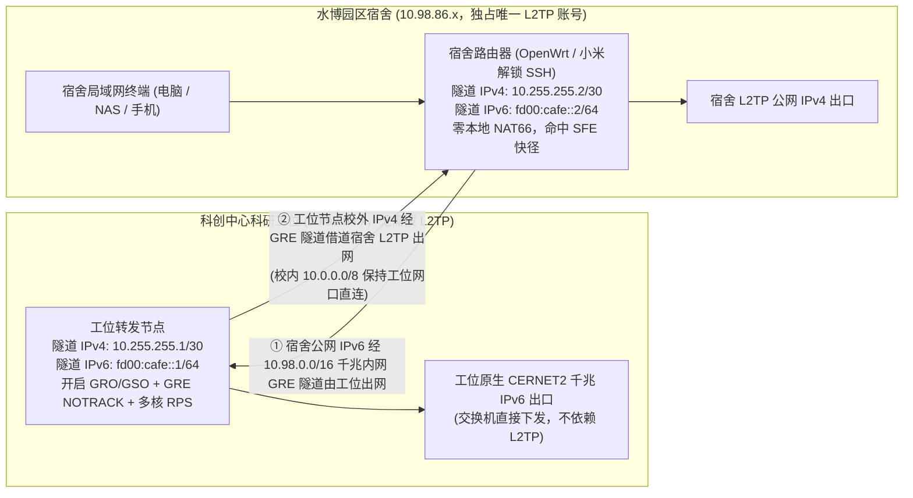

# 浙大科创中心水博园区宿舍千兆 IPv6 接入方案 (zju-dorm-ipv6-tunnel)

专门针对**浙江大学杭州国际科创中心水博园区宿舍**有线网口仅分配内网 IPv4（`10.98.86.x`）、无原生 IPv6 的场景，利用科创中心科研工位/实验室有线网口（`10.98.64.x` 等，具备原生 CERNET2 千兆 IPv6）与水博园区宿舍同属 `10.98.0.0/16` 千兆内网互通（RTT 仅 `1.2 ~ 1.8 ms`）的特性，实现**水博园区宿舍千兆 IPv6 接入与单 L2TP 账号双向共享**。

本仓库已针对 AI 编程助手（Codex / Claude Code / Cursor）完成自动化部署适配，克隆后直接交给 AI 即可完成双端配置与测速验收。

---

## 一、AI 一键式部署（直接复制发给 AI 助手）

将本仓库克隆到本地后，复制以下提示词发送给你的 **Codex / Claude Code / Cursor**：

> ```text
> 请阅读当前仓库中的 AGENTS.md，帮我完成水博园区宿舍路由器与工位节点的 IPv6 隧道一键部署与连通性测试。先探测我的本地网络环境，再向我询问缺失的 SSH 密码和 IP 参数。
> ```

AI 助手会自动探测本机网关、生成 `.env` 配置、配置双端免密 SSH、部署自愈守护服务，并在完成后自动运行教育网镜像站测速验收。

---

## 二、终态网络架构与实测性能

### 1. 单 L2TP 账号双向互补架构

针对校园网账号仅允许 **1 台设备**同时拨 L2TP（或希望完全不影响宿舍日常用网体验）的需求，方案默认采用**单 L2TP 双向互补模式（`ENABLE_OFFICE_L2TP="0"`）**：



- **水博宿舍体验**：宿舍路由器 100% 独占唯一的 L2TP 账号，IPv4 外网体验保持原样；同时宿舍局域网内所有设备自动获得原生教育网千兆 IPv6。
- **工位节点体验**：工位节点无需拨 L2TP，校内流量（`10.0.0.0/8`）直走工位物理网口，全球 IPv6 直走工位交换机出口，校外纯 IPv4 流量通过 GRE 隧道借道宿舍路由器出网。

### 2. 终态实测性能指标（工位 N3700 + 水博宿舍小米路由器）

| 测试项目 | 实测表现 |
| :--- | :--- |
| **水博宿舍 <-> 工位 GRE 隧道延迟 (RTT)** | **`1.23 ~ 1.55 ms`**（`0%` 丢包，走 `10.98.0.0/16` 园区千兆内网直连） |
| **GRE 隧道极限纯吞吐 (`iperf3 -6 -P 4`)** | **`840 Mbps` 发送 / `822 Mbps` 接收**（约 `105 MB/s`，已达千兆网口扣除包头后的物理线速上限） |
| **宿舍终端单线程公网 IPv6 下载速度** | **`37.8 ~ 42.1 MB/s` (`302 ~ 337 Mbps`)**（南京大学 / 北外 CERNET2 镜像源实测） |
| **宿舍终端 4 并发公网 IPv6 下载速度** | **`56.3 ~ 61.7 MB/s` (`450 ~ 494 Mbps`)** |

---

## 三、硬件选型指南：已实测平台与理论兼容平台

本仓库提供两套工位端部署脚本：
- **`scripts/deploy-office-linux.sh`**：适用于任何运行 **Debian / Ubuntu / Armbian** 的 x86 主机或 ARM 开发板；
- **`scripts/deploy-office-openwrt.sh`**：适用于开启了 SSH 的 **OpenWrt / 小米硬路由**。

### 1. 已实测验证平台 (Tested & Verified)

| 角色 | 硬件型号与处理器 | 系统环境 | 实测隧道吞吐 | 实测表现说明 |
| :--- | :--- | :--- | :--- | :--- |
| **工位节点（主力推荐）** | **Intel NUC5PGYH**<br>（Intel Pentium N3700 四核 x86_64 @ 2.4GHz，4G+32G eMMC，单千兆网口 + Intel 3165 无线网卡，二手约 ¥120~160） | Debian 12 (Bookworm) / 飞牛 fnOS（脚本支持一键静默剥离飞牛冗余服务转为纯 Debian 路由） | **`840 Mbps`**<br>(`105 MB/s`) | 64 位 x86 + Linux 6.x 原生支持 64KB `GRO/GSO` 超帧合并，打满千兆线速时 CPU 尚有 ~30% 余量，功耗仅 6~15W，自带无线网卡可开启应急管理热点。 |
| **工位节点（零成本备选）** | **小米路由器 AX3000E**<br>（高通 IPQ50xx 双核 ARMv7 Cortex-A7 @ 1.0GHz，开启 SSH） | 官方固件 (基于 OpenWrt 18.06, Linux 4.4) | **`273 Mbps`**<br>(`34.1 MB/s`) | 高通 NSS 硬件引擎不支持卸载 `ip_gre + NAT66` 复合流量，转发全部落入双核 Cortex-A7 软中断，约 270 Mbps 即达到双核 100% CPU 算力上限。 |
| **宿舍路由器（已实测）** | **小米路由器 (四核 IPQ53xx)**<br>（四核 Cortex-A7，开启 SSH） | 官方固件 (基于 OpenWrt 18.06, Linux 5.4) | **承接 `840 Mbps` 无瓶颈** | 本方案清空了宿舍路由器的本地 `miwifi_nat6`，宿舍侧仅做纯路由解封装并命中高通 `ecm_sfe_ipv6` 软件快径，跑满 840 Mbps 时 CPU 仍有 `48.7%` 空闲。 |

---

### 2. 未实测但理论完全可行的平台 (Theoretically Compatible)

只要工位设备能运行标准 Linux（Debian / Ubuntu / Armbian）或 OpenWrt，均可直接使用本仓库脚本部署。各主流硬件平台的预期性能与注意事项如下：

| 平台类别 | 代表机型 | 适用部署脚本 | 理论预期吞吐 | 兼容性分析与选购建议 |
| :--- | :--- | :--- | :--- | :--- |
| **树莓派系列**<br>(Raspberry Pi) | **树莓派 4B / 树莓派 5**<br>(BCM2711 四核 A72 / BCM2712 四核 A76) | `deploy-office-linux.sh`<br>(Raspberry Pi OS / Debian / Ubuntu) | **`800 ~ 840+ Mbps`** | **强烈推荐（手头有闲置板子时）**。4B 与 5 代均为独立千兆网口，64 位 ARMv8 算力充沛，且板载 Wi-Fi 可直接由脚本自动开启 `NUC-Rescue` 应急管理热点。<br>*(注：树莓派 3B/3B+ 因网口挂在 USB 2.0 总线上，物理极限仅 ~300 Mbps，不建议追求满速使用)* |
| **国产 ARM 软路由 / 开发板** | **友善 NanoPi R2S / R4S / R5S / R6S**<br>**香橙派 Orange Pi 3B / 5**<br>**Radxa Rock 5B** 等<br>(RK3328 / RK3566 / RK3568 / RK3588) | `deploy-office-linux.sh` (Armbian/Debian) 或 `deploy-office-openwrt.sh` (OpenWrt) | **R2S (RK3328): `600 ~ 750 Mbps`**<br>**R4S / RK356x / RK3588: `840+ Mbps`** | **非常适合**。64 位四核 Cortex-A53/A55/A72/A76 配合主线内核 `GRO/GSO` 均可高速转发；二手 R2S/R4S 体积小、直接采用 Type-C 5V 供电，放在工位极其省心（无无线网卡的机型脚本会自动跳过热点创建）。 |
| **其他 x86 迷你主机 / 软路由** | **Intel J1900 / J3455 / J4125 / N5105 / N100**<br>各类单网口或双网口工控小主机 | `deploy-office-linux.sh`<br>(Debian / Ubuntu) | **`840+ Mbps`**<br>(跑满千兆物理上限) | **闭眼入**。任何 2014 年以后的四核 x86 处理器在开启 `GRO/GSO` 后处理千兆 GRE + NAT66 都绰绰有余。单网口即可工作（单臂进出走千兆全双工独立收发差分线，带宽不折半）。 |
| **闲置旧笔记本电脑** | 任何带千兆网口（或插 USB 3.0 千兆网卡）的旧 x86 笔记本 | `deploy-office-linux.sh`<br>(Debian / Ubuntu) | **`840+ Mbps`** | **隐藏神器**。自带屏幕、键盘、无线网卡，且内置锂电池天然充当 **UPS 不间断电源**，工位偶发停电跳闸也不会关机。只需设置盒盖不休眠（`HandleLidSwitch=ignore`）即可。 |
| **MT798x 系列 OpenWrt 硬路由** | **小米 AX3000T / Redmi AX6000 / 360 T7**<br>(联发科 Filogic 820 MT7981 / Filogic 830 MT7986，开启 SSH 或刷 OpenWrt) | `deploy-office-openwrt.sh` | **`400 ~ 650 Mbps`** | 相比高通 IPQ50xx 的 32 位 Cortex-A7，联发科 MT7981/MT7986 采用 64 位 Cortex-A53（1.3~2.0GHz），即便纯靠 CPU 软中断转发 GRE 也能达到 400~650 Mbps。 |

---

## 四、工位无显示器“盲插网线开机”防失联机制

针对将小主机/开发板带到工位后无显示器、无键盘的操作场景，`scripts/deploy-office-linux.sh` 内置了四项自动化保障：

1. **宿舍待机 / 工位自动激活双模式**：在宿舍局域网（`192.168.*`）插网线预配置时自动处于 `dorm-standby` 待机模式；带去工位插上校园网口（`10.98.*`）通电 15 秒内自动切换为 `office-active` 模式并拉起 GRE 隧道。
2. **无限次 DHCP 重试 + 克隆 MAC 自动继承**：将 `NetworkManager` 的 `autoconnect-retries` 设为 `0`（无限重试），无论先开机还是先插网线都能自动获取 IP；支持配置 `OFFICE_CLONE_MAC` 直接继承工位原设备 IP。
3. **园区内网 SSH 主动推送 IP（免域名保底）**：工位节点拿到 `10.98.x.x` IP 后，立即通过 `10.98.0.0/16` 内网 SSH 将最新 IP 写入水博宿舍路由器的 `/tmp/office_nuc_ip` 并自动切换隧道对端，无需购买域名也能全自动运行。
4. **`NUC-Rescue` 本地无线应急热点**：若工位小主机具备无线网卡，开机自动广播 `NUC-Rescue` 热点（管理 IP `192.168.99.1`）。即使工位网口故障或未插网线，用笔记本连上该热点执行 `ssh root@192.168.99.1` 即可无线登录排障。

---

## 五、仓库目录结构

```text
.
├── AGENTS.md                       # AI 编程助手一键自动化部署协议 (Codex / Cursor)
├── CLAUDE.md                       # Claude Code 自动化部署协议
├── README.md                       # 方案架构、实测数据与硬件平台选型指南
├── .env.example                    # 双端参数配置模板 (复制为 .env 使用)
└── scripts/
    ├── deploy-dorm-openwrt.sh      # 水博宿舍端 OpenWrt / 小米路由器自动化部署脚本
    ├── deploy-office-linux.sh      # 工位端 Debian/Ubuntu (x86 / 树莓派 / ARM 开发板) 部署脚本
    ├── deploy-office-openwrt.sh    # 工位端 OpenWrt / 小米路由器部署脚本
    └── verify-tunnel.sh            # 隧道状态检查与教育网镜像站测速验收脚本
```
