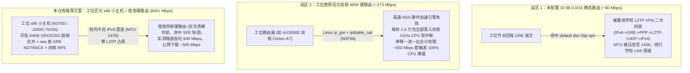
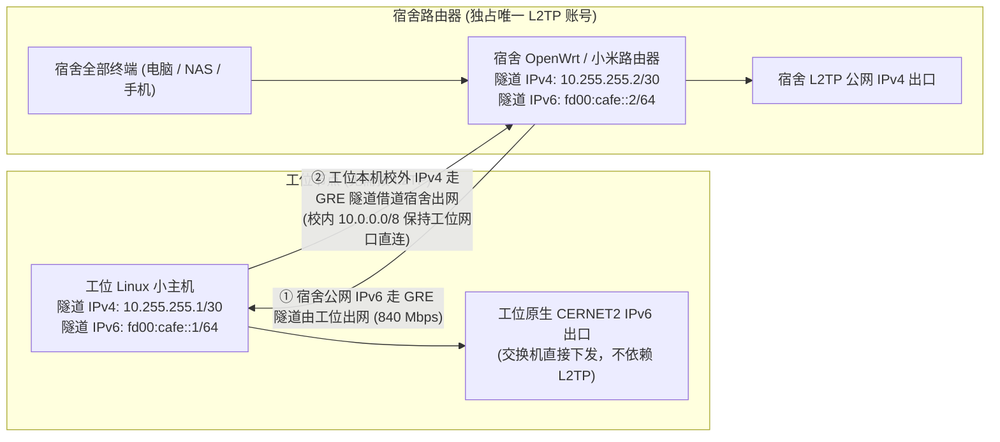

# 浙大科创中心水博园区宿舍千兆 IPv6 接入方案 (zju-dorm-ipv6-tunnel)

专门针对**浙江大学杭州国际科创中心水博园区宿舍**有线网口仅分配内网 IPv4（`10.98.86.x`）、无原生 IPv6 的问题，利用科创中心工位/实验室有线网口（`10.98.64.x` 等，具备原生 CERNET2 千兆 IPv6）与水博园区宿舍同属 `10.98.0.0/16` 千兆内网互通（RTT 仅 `1.2 ~ 1.8 ms`）的特性，打造的**水博园区宿舍千兆 IPv6 隧道与单 L2TP 账号双向共享方案**。

本仓库已针对 AI 编程助手（Codex / Claude Code / Cursor）做了全自动部署适配，并提供完整的硬件选型与避坑指南。

---

## 一、AI 一键式部署（发给你的 AI 助手即可）

把本仓库克隆到本地，直接复制下面这段话发送给你的 **Codex / Claude Code / Cursor**：

> ```text
> 请阅读当前仓库中的 AGENTS.md，帮我完成宿舍路由器与工位节点的水博园区宿舍 IPv6 隧道一键部署与连通性测试。先探测我的本地网络环境，再向我询问缺失的 SSH 密码和 IP 参数。
> ```

AI 助手会自动探测你的网关、生成 `.env` 配置、打通双端免密 SSH、写入防掉线自愈守护服务，并在部署完成后自动跑一遍 CERNET2 镜像站实测带宽验收。

---

## 二、为什么需要这套方案？常见方案的三大性能瓶颈

在浙大科创中心网络中，水博园区宿舍（`10.98.86.x`）与科创中心科研工位（`10.98.64.x`）在 `10.98.0.0/16` 内网层是千兆直连互通的（RTT 仅 `1.2 ~ 1.8 ms`），但普通自建 GRE 隧道往往只能跑到 `50 ~ 270 Mbps`，核心卡在以下三个瓶颈：



### 三个阶段的真实演进实测数据

| 阶段与方案 | 水博宿舍 <-> 工位 GRE 隧道带宽 (`iperf3`) | 宿舍单线程公网 IPv6 下载 | 宿舍 4 并发公网 IPv6 下载 | 满载时工位设备 CPU 状态 |
| :--- | :--- | :--- | :--- | :--- |
| **1. 初始双路由状态** (回程误入 `l2tp-vpn`) | `~69 Mbps` (`8.6 MB/s`) | `7.11 MB/s` (`56.9 Mbps`) | `8.61 MB/s` (`68.9 Mbps`) | 双核 ARM `sirq 75%+` |
| **2. 双路由优化后** (旁路 L2TP + 对齐 MTU 1476 + RPS) | `~273 Mbps` (`34.15 MB/s`) | `21.70 MB/s` (`173.6 Mbps`) | `34.15 MB/s` (`273.2 Mbps`) | **双核 ARM `96.9%`（算力见顶）** |
| **3. 工位换用 N3700 x86 小主机** (本仓库推荐方案) | **`840 Mbps` (`105.0 MB/s`)** | **`42.09 MB/s` (`336.7 Mbps`)** | **`61.72 MB/s` (`493.8 Mbps`)** | **四核 x86 仅占 `~70%`（全程满睿频 2.4GHz）** |

---

## 三、单 L2TP 账号双向互补架构（工位零 L2TP 占用）

如果校园网账号只允许 **1 台设备**同时拨 L2TP（或者不想影响宿舍路由器的正常外网体验），本仓库默认启用**单 L2TP 双向互补模式（`ENABLE_OFFICE_L2TP="0"`）**：



- **宿舍体验零影响**：唯一的 L2TP 账号由宿舍路由器 100% 独占，宿舍 IPv4 外网完全保持原样；同时宿舍所有设备自动获得接近千兆的原生教育网 IPv6。
- **工位节点同样具备双栈外网**：工位小主机的校内流量（`10.0.0.0/8`）直接走工位物理网口，原生 IPv6 直接走工位交换机出口，而校外纯 IPv4 流量自动通过 GRE 隧道借道宿舍路由器的 L2TP 出网。

---

## 四、工位节点硬件推荐

| 档位 | 推荐设备型号 | 二手参考价 | 实测 IPv6 隧道极限 | 适用人群与点评 |
| :--- | :--- | :--- | :--- | :--- |
| **零成本档** | 闲置小米路由器（AX3000E / AX3000T / CR880x，开启 SSH） | **¥0（利用旧路由）** | **~270 Mbps** (`~34 MB/s`) | 适合已有闲置路由器、对 30 MB/s 下载速度满意的同学，直接用 `scripts/deploy-office-openwrt.sh` 部署。 |
| **甜点性价比档（强烈推荐）** | **Intel NUC5PGYH / NUC5CPYH (N3700 / N3050)** 或 J1900 / J4125 迷你小主机 (4G+32G eMMC) | **¥100 ~ ¥180** | **840+ Mbps** (`~105 MB/s` 跑满千兆) | 功耗仅 5~10W，体积小巧，自带千兆网口 + Intel 无线网卡（可做应急管理热点），跑满千兆有线网口物理上限。 |
| **高配进阶档** | Intel N100 迷你主机 / 软路由 | **¥350 ~ ¥500** | **1000+ Mbps** | 适合后续还想在工位跑 Docker 或其他计算任务的同学；仅做 IPv6 隧道转发选百元 N3700 即已完全够用。 |

---

## 五、工位无显示器“盲插网线开机”防失联设计

工位通常没有多余的显示器和键盘，`scripts/deploy-office-linux.sh` 内置了四重防失联保障：

1. **宿舍待机 / 工位自动激活双模式**：在宿舍插网线（`192.168.*`）预配置时自动处于 `dorm-standby` 待机模式，不干扰现有网络；带去工位插上校园网（`10.98.*`）通电 15 秒内自动切换为 `office-active` 模式拉起隧道。
2. **无限次 DHCP 重试 + 克隆 MAC 自动继承**：修复了 `NetworkManager` 默认重试 4 次失败后放弃连接的问题（无论先开机还是先插网线都能自动连上），支持克隆工位原设备 MAC 直接继承原 IP。
3. **校内网主动推送 IP（免域名保底）**：工位小主机拿到 `10.98.x.x` IP 的瞬间，直接通过校内网 SSH 将自己的最新 IP 写入宿舍路由器的 `/tmp/office_nuc_ip` 并自动切换隧道对端。
4. **`NUC-Rescue` 本地无线应急热点（100% 物理保底）**：利用小主机自带的无线网卡自动广播 `NUC-Rescue` 热点（默认网关 `192.168.99.1`）。哪怕工位墙口彻底断网或网线没插好，带笔记本去工位连上该 Wi-Fi 执行 `ssh root@192.168.99.1` 即可直接登录排障。

---

## 六、仓库目录结构

```text
.
├── AGENTS.md                       # AI 编程助手一键自动化部署协议 (Codex / Cursor)
├── CLAUDE.md                       # Claude Code 自动化部署协议
├── README.md                       # 方案架构、实测数据与硬件选型指南
├── .env.example                    # 双端参数配置模板 (复制为 .env 使用)
└── scripts/
    ├── deploy-dorm-openwrt.sh      # 宿舍端 OpenWrt / 小米路由器自动化部署脚本
    ├── deploy-office-linux.sh      # 工位端 Debian/Ubuntu x86 小主机自动化部署脚本
    ├── deploy-office-openwrt.sh    # 工位端 OpenWrt / 小米路由器零成本方案部署脚本
    └── verify-tunnel.sh            # 园区工位隧道状态检查与 CERNET2 镜像站测速脚本
```
